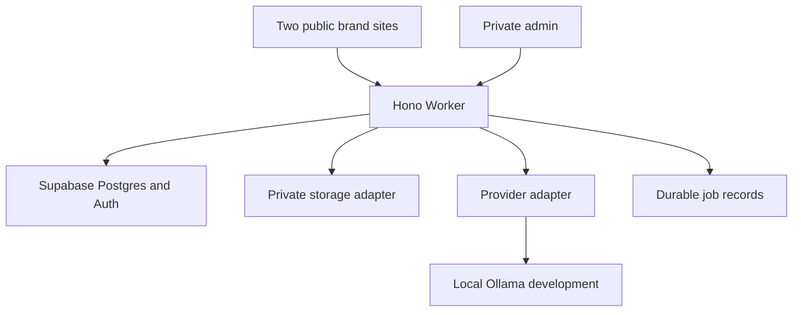

# Architecture proposal
Modular monolith: React/Vite/TypeScript/Tailwind public and admin apps, Hono Worker API, Supabase Postgres/Auth. Optional client portal later. pnpm workspace with shared UI, configuration and Zod schemas. Cloudflare Pages hosts frontends; Worker handles business operations. Resolve brands from validated host mapping, not arbitrary client headers. Public pages use published snapshots; plan prerendering for SEO. Arabic/English translations, RTL/LTR, accessible themes.

## Module boundaries
| Module | Responsibility |
|---|---|
| Identity | Auth, profiles, roles, permissions |
| Administration | CRUD, metrics, settings, audit |
| Brands | Domains, identity, navigation |
| Public web | Localized published content |
| Projects | Imports, immutable originals, tasks, versions, showcases |
| Learning | Owner-only curriculum, evidence, reports |
| AI foundation | Providers, agents, bounded tools |
| AI command | Policies, approvals and verified actions |
| Social | OAuth, drafts, approved publishing |
| Experience builder | Static previews first, isolated runtimes later |
| CMS | Drafts, revisions, publication |
| Business | Services, inquiries, CRM, proposals, conversion |
| Analytics | Actual events and derived metrics |
| Jobs | Scheduling, idempotency, retries |
| Backup | Export, restore and verification |
Modules own writes to their domain; cross-domain operations use explicit services and transactions. No microservices initially. Storage and AI use interfaces. Local Docker sandbox never shares production secrets; runtime execution disabled until separately hardened.
