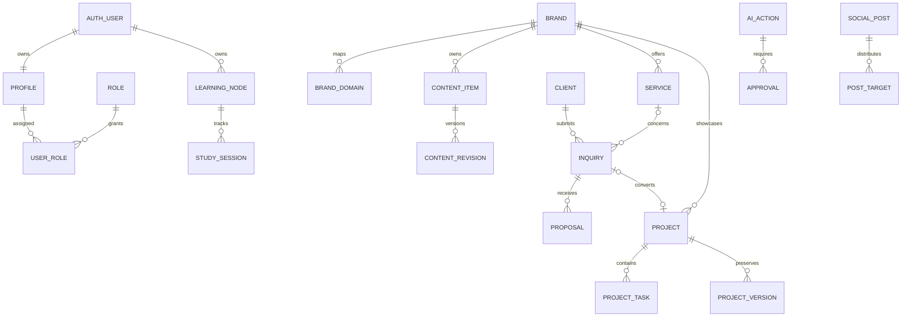

# Proposed database (not migrated)
Core: auth.users, profiles, roles, permissions, user_roles, role_permissions, audit_logs. Brands: brands, brand_domains, brand_settings, content_items, content_revisions, translations, media_assets. Projects: projects, project_sources, project_files, project_versions, project_tasks, project_milestones, showcases. Learning: learning_nodes (parent hierarchy), learning_resources, study_sessions, learning_goals, evidence. Business: service_categories, services, service_pricing, clients, client_contacts, client_inquiries, inquiry_status_history, proposals, proposal_items, agreements, communications. AI: providers, agents, agent_permissions, actions, approvals. Social: accounts, encrypted_connections, posts, post_targets, publishing_logs. Operations: notifications, jobs, feature_flags, backup_records, analytics_events.

Use UUID PKs, timestamptz UTC, explicit foreign keys, unique normalized domain and brand/locale/slug constraints, unique converted inquiry ID, idempotency keys. Index FK columns and owner/brand/status/date access paths. Monetary amounts numeric with ISO currency. Private records owner-scoped; public reads use explicit published projections only. RLS deny by default. Soft delete via deleted_at; permanent deletion requires approval and dependency checks. Proposed retention: configurable after owner review; no automatic destructive cleanup initially. Encrypted exports and restore drills required. Detailed field specifications and executable policies belong to implementation phases.

V0.8 adds `site_revisions(id INTEGER PRIMARY KEY, snapshot TEXT NOT NULL, created TEXT DEFAULT CURRENT_TIMESTAMP)` for transactional site configuration history. Existing records and profiles retained.

## Current V1.0 storage (supersedes persistent SQLite proposals)
See STORAGE-AR.md. JSON metadata per stable record ID; Markdown bodies; native project source files; JSON control/history records; local credentials excluded from GitHub. Atomic checkpoint pointer uses SHA-256 manifest and two local snapshots, with an in-memory SQL projection rebuilt on startup. Legacy SQLite opened read-only only when no file data is restored. GitHub `db/` mirror uses Git Objects API and non-force updates; single writer, no manual edits, no automatic conflict merge. Acknowledged API writes are durable on local disk, not necessarily remote until successful sync.
